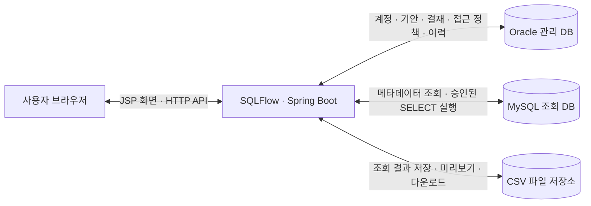

# SQLFlow

SQLFlow는 사내 데이터 조회·변경 요청을 기안하고, 결재부터 실행 결과 확인까지 처리하는 업무 포털입니다.

## 시연 환경

[SQLFlow 데모 열기](http://13.124.37.144:8080/)

| 계정 ID | 역할 | 체험할 기능 |
| --- | --- | --- |
| `test` | 실무자 | 데이터 조회 요청 작성·제출, 실행 결과 확인 |
| `a-test` | 결재자 | 받은 결재에서 요청 검토·승인 |
| `db-test` | DB팀 SQL 실행자 | 최종 승인된 조회 SQL 실행 |

`test`로 조회 요청을 제출하고, `a-test`로 배정된 결재를 처리합니다.
최종 승인 후 `db-test`로 SQL을 실행한 뒤, `test`로 돌아와 결과를 확인합니다.

세 시연 계정의 공통 비밀번호는 `test`입니다.

## 주요 기능

### 요청 처리 흐름

1. **기안**에서 요청 목적을 작성하고 SQL별 제목과 원문을 입력합니다. 데이터 변경 요청을 재기안하면 기존 요청 유형에 맞는 작성 화면이 열립니다.
2. **결재**를 위해 결재선을 지정해 제출합니다. 배정된 결재자는 받은 결재에서 요청을 승인하거나 반려합니다.
3. **조회 요청**은 최종 승인 후 쿼리 실행 대기 화면에서 실행하고, 쿼리 실행 결과에서 확인합니다.
4. **데이터 변경 요청**은 최종 승인 후 부서 기안 상세에서 SQL 파일을 내려받아 외부에서 처리합니다. 담당자는 같은 화면에서 처리 결과를 등록합니다.

조회 요청의 **AI 작성 · 시연**은 키워드 기반 SQL 예시를 생성합니다.

### 주요 화면

| 화면 | 경로 | 기능 |
| --- | --- | --- |
| Home | `/` | 내 기안 현황, 받은 결재, 공지사항, 부서 일정 |
| 뷰 조회 | `/views` | 뷰 목록·상세 조회, 컬럼 논리명·설명 편집, 마지막 수정자·수정 시각 확인 |
| 데이터 조회 요청 | `/requests/new` | SELECT 직접 작성 또는 AI 작성 시연, 저장 전 SQL 검증 |
| 데이터 변경 요청 | `/view-create-requests/new` | `CREATE VIEW`, `INSERT`, `UPDATE`, `DELETE` 기안 |
| 내 기안함 · 부서 기안함 | `/requests`, `/department-requests` | 기안 검색과 상세 조회, 내 초안 수정, 제출한 기안 회수·재기안, 부서 기안의 변경 처리 결과 확인 |
| 받은 결재 | `/approvals/pending` | 배정된 요청 검토, 승인·반려, 결재 이력 확인 |
| 쿼리 실행 대기 | `/execution-queue` | 활성 `DB_APPROVER` 계정에서 승인된 조회 SQL의 개별·묶음 실행 |
| 쿼리 실행 결과 | `/execution-results` | 실행 상태 확인, 최대 100행 미리보기, 전체 CSV 다운로드 |
| 리소스·접근 정책 관리 | `/db-admin/resources` | 조회 리소스 및 부서별 접근·반출 정책 관리 |
| 계정 목록 · 계정 관리 | `/accounts`, `/admin/users/new` | 계정 조회, 시스템 관리자의 계정 생성·역할 부여·비밀번호 초기화 |
| 내 프로필 · 공지사항 | `/my-page`, `/notices` | 내 정보·비밀번호 변경, 공지사항 확인 |

상단바에서 현재 메뉴 경로를 확인할 수 있습니다. 관리자 화면에서 계정을 생성할 때는 `YYYY-NNNNN` 형식의 사번이 필요하며, 등록된 사번은 중복 사용할 수 없습니다.

## 기술 스택

| 구분 | 기술 |
| --- | --- |
| 백엔드 | Java 21, Spring Boot 4.1.1, Spring MVC, Spring Security, Jakarta Bean Validation, Lombok |
| 웹 화면 | JSP, Jakarta Tags(JSTL), JavaScript(Fetch API), CSS |
| DB 연동 | Oracle 관리 DB, MySQL 조회 DB, Oracle JDBC(ojdbc11), MySQL Connector/J, MyBatis Spring Boot Starter 4.0.0, HikariCP |
| SQL·CSV 처리 | JSqlParser 5.3(SQL 구문 분석), Apache Commons CSV 1.14.1(CSV 미리보기), SQL Formatter(뷰 정의 표시) |
| 테스트 | JUnit Jupiter, Mockito, Spring MockMvc, Spring Security Test |
| 빌드·실행 | Maven, Spring Boot Maven Plugin, 내장 Tomcat·Jasper가 포함된 실행 가능한 WAR |

의존성 선언과 버전은 Maven 설정에서 확인할 수 있습니다. [pom.xml](pom.xml)

## 시스템 구성

## 핵심 구현

### SQL 검증과 결재

조회 SQL은 작성·수정·재기안 화면에서 저장 전에 검증합니다. SELECT 문장 구조, MySQL 메타데이터, 요청자의 접근 정책을 확인합니다. 제출 시 서버는 Oracle에 저장된 SQL을 다시 검사하며, 검증을 통과하면 결재선 생성과 제출 상태 변경을 하나의 트랜잭션에서 처리합니다.

### 조회 실행과 변경 처리

최종 승인된 조회 요청은 활성 `DB_APPROVER` 계정으로 SQL을 개별 또는 묶음 실행할 수 있습니다. 실행 이력은 Oracle에, 조회 데이터는 CSV 파일에 저장합니다. 데이터 변경은 외부에서 처리한 뒤 부서 기안 상세에서 SQL별 결과를 등록·수정하며, 변경 이력을 남깁니다.

### 결과 접근과 보관

미리보기와 CSV 다운로드를 요청할 때 결과 열람 자격과 파일 상태를 확인하고, 계정에 적용되는 조회·반출 정책을 검사합니다. 미리보기·다운로드 요청은 접근 이력에 남깁니다. 결과 파일은 생성 후 30일 동안 보관하며, 스케줄러가 만료된 파일을 정리합니다.
